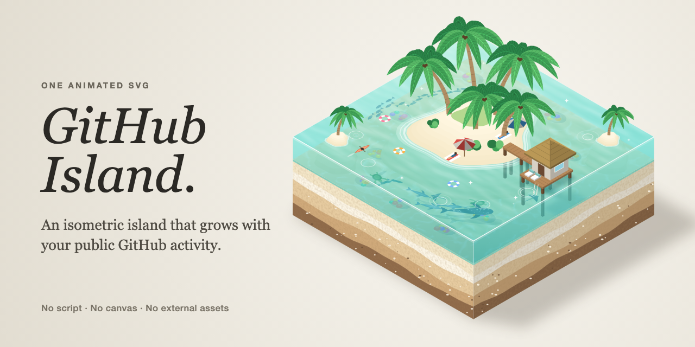

# github-island



An isometric island, drawn as one animated SVG, that grows with public GitHub activity.

**[Playground](https://andrewdongminyoo.github.io/github-island/)** · [Usage](#usage) · [Activity mapping](#activity-mapping) · [Published output](https://github.com/AndrewDongminYoo/github-island/tree/output)

<table>
  <tr>
    <td align="center"><br><b>Live</b></td>
    <td align="center"><br><b>Quiet</b></td>
    <td align="center"><br><b>Mostly pull requests</b></td>
  </tr>
  <tr>
    <td align="center"><br><b>Mostly reviews</b></td>
    <td align="center"><br><b>Many stars and forks</b></td>
    <td align="center"><br><b>Everything</b></td>
  </tr>
</table>

**Live** is the file that the daily workflow publishes on the [`output` branch](https://github.com/AndrewDongminYoo/github-island/tree/output), next to its `state.json` and `manifest.json`; the other five are fixed examples from `examples/`.

## Activity mapping

The island is always the same island.
What changes with activity is who comes to it.
Each signal is a number from 0 to 1.

| Signal                           | What it brings                                                                                      |
| -------------------------------- | --------------------------------------------------------------------------------------------------- |
| Pull requests                    | Sea animals, larger with more activity: fish, then turtles, rays, a pod of dolphins, a whale shark  |
| Reviews or outside contributions | Visitors: float rings, then a canoe, parasols with sunbathers, and up to three bungalows on a jetty |
| Issues                           | Reefs on the seabed                                                                                 |
| Stars                            | Glints on the water                                                                                 |
| Forks                            | Satellite islets around the island                                                                  |

An outside contribution is a pull request or an issue opened in a public repository that the account does not own, which includes a repository of an organization.
Visitors follow whichever of the two signals is larger, because both are work done for someone else.

The number and height of the palms follow overall growth, which the prototype takes as the mean of pull requests, reviews and issues.

## Usage

The package needs Python 3.12 or later and has no runtime dependencies.

```bash
python -m pip install -e .
python -m github_island scene OUTPUT.svg [--profile PROFILE] [--transparent] [--key KEY]
```

- `--profile` is five comma-separated numbers from 0 to 1 in the order pull requests, reviews, issues, stars, forks.
- `--transparent` removes the backdrop and the title text and crops the view to the block.
- `--key` seeds the random choices, so each key gets its own island and the same key always gets the same one.

```bash
python -m github_island scene island.svg --profile 0.65,0.65,0.6,0.6,0.34 --transparent
```

`python tools/examples.py` rewrites the scenes under `examples/`, and a test fails when they no longer match the renderer.
Open `preview.html` in a browser to see them side by side.

### From real activity

These commands read public data with a token in `GH_TOKEN` and write nothing to GitHub.
`island.toml` names the account.

```bash
python -m github_island collect --repository OWNER/REPOSITORY --start START_DAY > snapshot.json
python -m github_island grow --snapshot snapshot.json --bootstrap > state.json
python -m github_island draw --state state.json island.svg
```

`build` does the last two steps together and writes `island.svg`, `state.json` and `manifest.json` into one directory, and `validate` checks such a directory.

```bash
python -m github_island build --snapshot snapshot.json --bootstrap --bundle-dir bundle --source-commit "$(git rev-parse HEAD)"
python -m github_island validate --bundle-dir bundle
```

The validator is an allowlist with budgets.
It accepts only the elements, attributes, classes and stylesheet that the renderer writes, refuses script and anything that reaches outside the file, checks that every reference resolves inside the file, and bounds the size, the element count, the depth and the animation count.
Every attribute has a grammar of its own, so a keyword such as `click` on an animation or a function such as `URL(...)` on a paint cannot pass.
It does not parse geometry, so it cannot tell whether a path draws the right shape.

A first state needs exactly 30 completed days, so `START_DAY` is 30 days before today in UTC.
`--repository` names the repository that hosts the island; activity inside it is left out of the counts, so publishing the image never feeds the image.
The growth stage comes from the experience that the state has accumulated and drives the palms.
Pull requests, reviews, issues and outside contributions follow the counts of the last 30 days; stars and forks are the current totals over the account's own public repositories that are not forks.
Each signal is on a logarithmic scale that reaches 1 at 30 pull requests, 60 reviews, 20 issues, 10 outside contributions, 500 stars and 100 forks, and stays at 1 above that.
Outside contributions are rare, so their scale is short: five of them in 30 days already bring a bungalow.
The `scene` command takes no outside value; raise the review value there to see visitors.

### Publication

`generate` does the whole run: it reads the `output` branch, collects the days that the published state still needs, grows the state, builds and validates the bundle, and publishes it as one new commit on `output`.
It never force-pushes. When another run published first, it starts over once from a fresh read.

```bash
python -m github_island generate --config island.toml --repository OWNER/REPOSITORY --source-commit "$(git rev-parse HEAD)"
```

The `Daily generation` workflow runs this command once a day and on manual dispatch.
A scheduled run fails with `Output branch is absent` until one manual dispatch with the `bootstrap` input creates the branch.
`publish` publishes a bundle that was built separately, and `restore` brings back an earlier published bundle through a new commit, so the history of `output` is never rewritten.

## Playground

Try it at [andrewdongminyoo.github.io/github-island](https://andrewdongminyoo.github.io/github-island/).

`playground/index.html` is a page with a slider for each signal and a choice of growth stage.
It redraws the island on every change, shows its size against the byte budget, and keeps the settings in the address so that a view can be shared.
The language selector supports English and Korean, initially follows the browser language, and remembers an explicit choice when local storage is available.

The page does not have a renderer of its own.
It loads [Pyodide](https://pyodide.org) and runs `render.py` and the modules it imports in the browser, so the page and the published image always come from the same code.
The first load fetches the Python runtime from a CDN and takes a few seconds; after that, drawing and slider changes happen in the browser.
Account lookup sends the entered username to a separately hosted preview API.

```bash
python tools/playground.py work/site
python -m http.server --directory work/site
```

The `Playground` workflow builds the same site and deploys it to GitHub Pages on a push to `main`.

### Account previews

When a preview API is configured, enter a GitHub username to see a new island bootstrapped from the last 30 completed UTC days of public activity.
No visitor sign-in or token is required.
The result shows the collection dates and exact counts; stars and forks are observed at lookup time.
It does not reconstruct lifetime growth or an existing published island.
Changing the signals, stage, or key marks the result as an edited preview.
Shared links preserve the scene settings and do not perform another account lookup.

The API reuses the existing public collector and growth calculation.
It excludes activity in its configured hosting repository, initially `AndrewDongminYoo/github-island`.
A publication configured with a different exclusion repository can produce a different result.
An incomplete lookup leaves the current scene intact instead of showing zero activity.

GitHub Pages hosts the static interface; it cannot run the Python lookup service.
Deploy the WSGI application `github_island.preview:application` separately and set the repository variable `PREVIEW_API_URL` to its HTTPS base URL for the Pages build.
Without that variable, the site keeps its presets and sliders and explains that account preview is unavailable.
The API URL is public configuration, not a secret.

Set these variables only in the API's server environment:

| Variable             | Purpose                                                                                                         |
| -------------------- | --------------------------------------------------------------------------------------------------------------- |
| `PREVIEW_GH_TOKEN`   | A dedicated credential that can read public GitHub GraphQL data. Never put it in Pages assets or browser input. |
| `PREVIEW_ORIGIN`     | Exact allowed browser origin, such as `https://andrewdongminyoo.github.io`, without a path or trailing slash.   |
| `PREVIEW_REPOSITORY` | Repository excluded from activity; defaults to `AndrewDongminYoo/github-island`.                                |

For local development, set `PREVIEW_GH_TOKEN` in the API process environment, then start the API and static site in separate terminals:

```bash
PREVIEW_ORIGIN=http://127.0.0.1:8000 python -m github_island.preview --port 8787
```

```bash
PREVIEW_API_URL=http://127.0.0.1:8787 python tools/playground.py work/site
python -m http.server --bind 127.0.0.1 --directory work/site 8000
```

The loopback development server is not a production server.
Production requires an HTTPS WSGI host with one server process, multiple request threads, and one instance, plus a provider-side request limit.
The host must allow a short-lived child Python process for each uncached lookup.
The server sends credentials through a private pipe and kills and reaps that child if the entire collection exceeds 60 seconds, including slow network operations.
Configure its request timeout above the API's 60-second collection budget and below the browser's 75-second wait budget.
The service allows one active collection and globally limits new lookups to two per minute and 60 per hour, counting failures.
It caches up to 128 successful results for 15 minutes, expires them at UTC midnight, and caps each collection at 64 upstream requests including retries.
Cache hits do not consume the lookup quota.
These controls are in memory: restarts reset them, and multiple server processes or replicas would each have their own allowance.
CORS does not replace the provider-side request limit.

For AWS Lambda, build the deployment package with `python tools/lambda_bundle.py work/lambda.zip` and use `github_island.lambda_preview.handler` with Python 3.12.
Configure 256 MiB of memory, a 70-second timeout, and reserved concurrency of one.
Use a Function URL with buffered responses and configure its CORS origin to match `PREVIEW_ORIGIN`; the adapter leaves CORS response headers to the Function URL.
Public URL access requires both `lambda:InvokeFunctionUrl` and `lambda:InvokeFunction`, with the latter restricted to invocation through the Function URL.
Lambda environment replacement can reset the in-memory cache and lookup allowance even with reserved concurrency of one.
Hosting, credentials, and a live end-to-end lookup must be verified before enabling the public API URL.

## Status

This is an early prototype that runs end to end.
The package collects public GitHub activity, reconciles it into a growth state, draws the island for that state, validates the image, and publishes the image, the state and a manifest together.
The first publication was a manual bootstrap run on 2026-11-19, recorded in [the publication note](docs/notes/2026-11-19-first-publication.md).
The first scheduled run, on 2026-11-20, started 7 hours after its cron time and updated the image; [its note](docs/notes/2026-11-20-first-scheduled-run.md) has the details.
So the daily image does not arrive at a fixed time.
The pipeline comes from [github-terrarium](https://github.com/AndrewDongminYoo/github-terrarium), and [the port plan](docs/plans/2026-11-19-pipeline-port.md) records the steps and the decisions.

## How it works

- The scene is modelled in 3D world units in Python, projected to an isometric view, and painted from far to near.
- The output is one SVG file with no script, no canvas and no external assets, so it renders inside an `` tag, which is how a README shows it.
- CSS keyframes move the palm fronds, the ripples, the glints and the small waves on the beach.
- SMIL moves the sea animals and the canoe along paths that lie in a plane below or on the water surface.
- The water shading is filter lighting on a noise height map, blended over the scene.
- Shapes that repeat are defined once and placed with `use`: the fronds of two palm crowns, the bungalow, a jetty segment, a post and a glint. The projection is isometric, so a copy only needs a translation.
- The transparent variant carries no text and no backdrop, so it sits on light and dark pages alike; only the shadow under the block follows `prefers-color-scheme`.

## Development

```bash
python -m pip install --require-hashes -r requirements-dev.txt
python -m pip install -e .
python -m unittest discover -s tests -v
node --test tests/test_*.mjs
ruff check src tests tools
ruff format --check src tests tools
```

[CONTRIBUTING.md](CONTRIBUTING.md) has the rules for a change and for a pull request.
The browser-controller and language tests use Node.js 22.7 or later and require no npm dependencies.

## Known limits

- The viewpoint is fixed. An image in a README cannot run script or receive pointer input, so there is no camera control, no interaction and no physics.
- The examples are between 62 kB and 118 kB. Every palm shares one of two crowns, mirrored and scaled, so palms look more alike than hand-drawn ones would. [The size note](docs/notes/2026-11-19-svg-size-options.md) lists what would shrink them further.
- Objects are sorted by the distance of their centre, so objects that pass through each other are painted in the wrong order. Sea animals and the canoe also pass under jetties and through posts without being hidden by them.
- Animals and visitors hold one pose. They move along a path, but they do not jump, walk or react to each other.
- The water shading recomputes a filter on every frame. Its playback cost is not measured.
- Rendering and animation were checked in a GitHub README on the web in Chrome with the dark theme, and in the GitHub mobile app on iOS. Other browsers and the light theme on GitHub are not confirmed yet. [The rendering note](docs/notes/2026-11-19-rendering-checks.md) says how to capture a scene and what a capture cannot prove.

## License

[MIT](LICENSE)
