# github-island

An isometric island, drawn as one animated SVG, that is meant to grow with public GitHub activity.


## Status

This is an early prototype.
The generator draws the scene from activity numbers passed on the command line.
Collecting real GitHub activity, keeping growth between runs, and publishing the image every day are not implemented yet.
[github-terrarium](https://github.com/AndrewDongminYoo/github-terrarium) has that pipeline for a different scene, and this project is meant to reuse its approach.

## How it works

- The scene is modelled in 3D world units in Python, projected to an isometric view, and painted from far to near.
- The output is one SVG file with no script, no canvas and no external assets, so it renders inside an `` tag, which is how a README shows it.
- CSS keyframes move the palm fronds, the ripples, the glints and the small waves on the beach.
- SMIL moves the sea animals and the canoe along paths that lie in a plane below or on the water surface.
- The water shading is filter lighting on a noise height map, blended over the scene.
- The transparent variant carries no text and no backdrop, so it sits on light and dark pages alike; only the shadow under the block follows `prefers-color-scheme`.

## Activity mapping

The island is always the same island.
What changes with activity is who comes to it.
Each signal is a number from 0 to 1.

| Signal        | What it brings                                                                                      |
| ------------- | --------------------------------------------------------------------------------------------------- |
| Pull requests | Sea animals, larger with more activity: fish, then turtles, rays, a pod of dolphins, a whale shark  |
| Reviews       | Visitors: float rings, then a canoe, parasols with sunbathers, and up to three bungalows on a jetty |
| Issues        | Reefs on the seabed                                                                                 |
| Stars         | Glints on the water                                                                                 |
| Forks         | Satellite islets around the island                                                                  |

The number and height of the palms follow overall growth, which the prototype takes as the mean of pull requests, reviews and issues.

**Quiet**


**Mostly pull requests**


**Mostly reviews**



**Many stars and forks**



**Everything**


## Usage

The generator needs Python 3 and only the standard library.

```bash
python3 generate.py OUTPUT.svg [PROFILE] [transparent]
```

- `PROFILE` is five comma-separated numbers from 0 to 1 in the order pull requests, reviews, issues, stars, forks.
- `transparent` removes the backdrop and the title text and crops the view to the block.

```bash
python3 generate.py examples/island.svg 0.65,0.65,0.6,0.6,0.34 transparent
```

Open `preview.html` in a browser to see the example profiles side by side.

## Known limits

- The viewpoint is fixed. An image in a README cannot run script or receive pointer input, so there is no camera control, no interaction and no physics.
- Dense scenes are large. The examples are between 79 kB and 278 kB.
- Objects are sorted by the distance of their centre, so objects that pass through each other are painted in the wrong order. Sea animals and the canoe also pass under jetties and through posts without being hidden by them.
- Animals and visitors hold one pose. They move along a path, but they do not jump, walk or react to each other.
- The water shading recomputes a filter on every frame. Its playback cost is not measured.
- Rendering and animation were checked in a GitHub README on the web in Chrome with the dark theme, and in the GitHub mobile app on iOS. Other browsers and the light theme on GitHub are not confirmed yet.

## License

[MIT](LICENSE)
