# github-island

An isometric island, drawn as one animated SVG, that is meant to grow with public GitHub activity.



## Status

This is an early prototype.
The generator draws the scene from activity numbers passed on the command line.
Collecting real GitHub activity, keeping growth between runs, and publishing the image every day are not implemented yet.
[github-terrarium](https://github.com/AndrewDongminYoo/github-terrarium) has that pipeline for a different scene, and this project is meant to reuse its approach.

## How it works

- The scene is modelled in 3D world units in Python, projected to an isometric view, and painted from far to near.
- The output is one SVG file with no script, no canvas and no external assets, so it renders inside an `` tag, which is how a README shows it.
- CSS keyframes move the palm fronds, the ripples, the glints and the small waves on the beach.
- SMIL moves the fish and the rays along paths that lie in a plane below the water surface.
- The water shading is filter lighting on a noise height map, blended over the scene.
- The transparent variant carries no text and no backdrop, so it sits on light and dark pages alike; only the shadow under the block follows `prefers-color-scheme`.

## Activity mapping

The prototype maps five signals, each from 0 to 1, to parts of the island.

| Signal        | What grows                          |
| ------------- | ----------------------------------- |
| Pull requests | Number and height of palms, bushes  |
| Reviews       | Size of the fish schools, rays      |
| Issues        | Number of reefs                     |
| Stars         | Glints on the water                 |
| Forks         | Satellite islets around the island  |

This mapping is a placeholder.
The planned direction is that pull requests attract larger animals and reviews bring visitors to the island.

The same generator gives a different island for each profile.

**Mostly pull requests**



**Mostly reviews and issues**


**Many stars and forks**


## Usage

The generator needs Python 3 and only the standard library.

```bash
python3 generate.py OUTPUT.svg BUNGALOWS [PROFILE] [transparent]
```

- `BUNGALOWS` is the number of stilt bungalows, from 0 to 7. With 0 the island is deserted, sits in the middle of the block, and follows `PROFILE`.
- `PROFILE` is five comma-separated numbers from 0 to 1 in the order pull requests, reviews, issues, stars, forks.
- `transparent` removes the backdrop and the title text and crops the view to the block.

```bash
python3 generate.py examples/island.svg 0 0.6,0.6,0.6,0.6,0.34 transparent
python3 generate.py examples/lagoon.svg 7 transparent
```

The second command draws the inhabited variant.



## Known limits

- The viewpoint is fixed. An image in a README cannot run script or receive pointer input, so there is no camera control, no interaction and no physics.
- Dense scenes are large. The inhabited example is about 247 kB and the island examples are between 112 kB and 176 kB.
- Objects are sorted by the distance of their centre, so objects that pass through each other are painted in the wrong order.
- The water shading recomputes a filter on every frame. Its playback cost is not measured.
- Rendering and animation were checked in a GitHub README on the web in Chrome with the dark theme, and in the GitHub mobile app on iOS. Other browsers and the light theme on GitHub are not confirmed yet.

## License

[MIT](LICENSE)
