# github-island

An isometric island, drawn as one animated SVG, that grows with public GitHub activity.


The image above is live: it is the file that the daily workflow publishes on the [`output` branch](https://github.com/AndrewDongminYoo/github-island/tree/output), next to its `state.json` and `manifest.json`.

## Status

This is an early prototype that runs end to end.
The package collects public GitHub activity, reconciles it into a growth state, draws the island for that state, validates the image, and publishes the image, the state and a manifest together.
The first publication was a manual bootstrap run on 2026-11-19, recorded in [the publication note](docs/notes/2026-11-19-first-publication.md).
Scheduled runs have not been observed yet, so nothing here claims that they start on time.
The pipeline comes from [github-terrarium](https://github.com/AndrewDongminYoo/github-terrarium), and [the port plan](docs/plans/2026-11-19-pipeline-port.md) records the steps and the decisions.

## How it works

- The scene is modelled in 3D world units in Python, projected to an isometric view, and painted from far to near.
- The output is one SVG file with no script, no canvas and no external assets, so it renders inside an `` tag, which is how a README shows it.
- CSS keyframes move the palm fronds, the ripples, the glints and the small waves on the beach.
- SMIL moves the sea animals and the canoe along paths that lie in a plane below or on the water surface.
- The water shading is filter lighting on a noise height map, blended over the scene.
- Shapes that repeat are defined once and placed with `use`: the fronds of two palm crowns, the bungalow, a jetty segment, a post and a glint. The projection is isometric, so a copy only needs a translation.
- The transparent variant carries no text and no backdrop, so it sits on light and dark pages alike; only the shadow under the block follows `prefers-color-scheme`.

## Activity mapping

The island is always the same island.
What changes with activity is who comes to it.
Each signal is a number from 0 to 1.

| Signal                           | What it brings                                                                                      |
| -------------------------------- | --------------------------------------------------------------------------------------------------- |
| Pull requests                    | Sea animals, larger with more activity: fish, then turtles, rays, a pod of dolphins, a whale shark  |
| Reviews or outside contributions | Visitors: float rings, then a canoe, parasols with sunbathers, and up to three bungalows on a jetty |
| Issues                           | Reefs on the seabed                                                                                 |
| Stars                            | Glints on the water                                                                                 |
| Forks                            | Satellite islets around the island                                                                  |

An outside contribution is a pull request or an issue opened in a public repository that the account does not own, which includes a repository of an organization.
Visitors follow whichever of the two signals is larger, because both are work done for someone else.

The number and height of the palms follow overall growth, which the prototype takes as the mean of pull requests, reviews and issues.

**Quiet**


**Mostly pull requests**


**Mostly reviews**


**Many stars and forks**


**Everything**



## Usage

The package needs Python 3.12 or later and has no runtime dependencies.

```bash
python -m pip install -e .
python -m github_island scene OUTPUT.svg [--profile PROFILE] [--transparent] [--key KEY]
```

- `--profile` is five comma-separated numbers from 0 to 1 in the order pull requests, reviews, issues, stars, forks.
- `--transparent` removes the backdrop and the title text and crops the view to the block.
- `--key` seeds the random choices, so each key gets its own island and the same key always gets the same one.

```bash
python -m github_island scene island.svg --profile 0.65,0.65,0.6,0.6,0.34 --transparent
```

`python tools/examples.py` rewrites the scenes under `examples/`, and a test fails when they no longer match the renderer.
Open `preview.html` in a browser to see them side by side.

### From real activity

These commands read public data with a token in `GH_TOKEN` and write nothing to GitHub.
`island.toml` names the account.

```bash
python -m github_island collect --repository OWNER/REPOSITORY --start START_DAY > snapshot.json
python -m github_island grow --snapshot snapshot.json --bootstrap > state.json
python -m github_island draw --state state.json island.svg
```

`build` does the last two steps together and writes `island.svg`, `state.json` and `manifest.json` into one directory, and `validate` checks such a directory.

```bash
python -m github_island build --snapshot snapshot.json --bootstrap --bundle-dir bundle --source-commit "$(git rev-parse HEAD)"
python -m github_island validate --bundle-dir bundle
```

The validator is an allowlist with budgets.
It accepts only the elements, attributes, classes and stylesheet that the renderer writes, refuses script and anything that reaches outside the file, checks that every reference resolves inside the file, and bounds the size, the element count, the depth and the animation count.
Every attribute has a grammar of its own, so a keyword such as `click` on an animation or a function such as `URL(...)` on a paint cannot pass.
It does not parse geometry, so it cannot tell whether a path draws the right shape.

A first state needs exactly 30 completed days, so `START_DAY` is 30 days before today in UTC.
`--repository` names the repository that hosts the island; activity inside it is left out of the counts, so publishing the image never feeds the image.
The growth stage comes from the experience that the state has accumulated and drives the palms.
Everything else follows the counts of the last 30 days, on a logarithmic scale that reaches 1 at 30 pull requests, 60 reviews, 20 issues, 10 outside contributions, 500 stars and 100 forks.
Outside contributions are rare, so their scale is short: five of them in 30 days already bring a bungalow.
The `scene` command takes no outside value; raise the review value there to see visitors.

### Publication

`generate` does the whole run: it reads the `output` branch, collects the days that the published state still needs, grows the state, builds and validates the bundle, and publishes it as one new commit on `output`.
It never force-pushes. When another run published first, it starts over once from a fresh read.

```bash
python -m github_island generate --config island.toml --repository OWNER/REPOSITORY --source-commit "$(git rev-parse HEAD)"
```

The `Daily generation` workflow runs this command once a day and on manual dispatch.
A scheduled run fails with `Output branch is absent` until one manual dispatch with the `bootstrap` input creates the branch.
`publish` publishes a bundle that was built separately, and `restore` brings back an earlier published bundle through a new commit, so the history of `output` is never rewritten.

## Development

```bash
python -m pip install --require-hashes -r requirements-dev.txt
python -m pip install -e .
python -m unittest discover -s tests -v
ruff check src tests tools
ruff format --check src tests tools
```

## Known limits

- The viewpoint is fixed. An image in a README cannot run script or receive pointer input, so there is no camera control, no interaction and no physics.
- The examples are between 62 kB and 118 kB. Every palm shares one of two crowns, mirrored and scaled, so palms look more alike than hand-drawn ones would. [The size note](docs/notes/2026-11-19-svg-size-options.md) lists what would shrink them further.
- Objects are sorted by the distance of their centre, so objects that pass through each other are painted in the wrong order. Sea animals and the canoe also pass under jetties and through posts without being hidden by them.
- Animals and visitors hold one pose. They move along a path, but they do not jump, walk or react to each other.
- The water shading recomputes a filter on every frame. Its playback cost is not measured.
- Rendering and animation were checked in a GitHub README on the web in Chrome with the dark theme, and in the GitHub mobile app on iOS. Other browsers and the light theme on GitHub are not confirmed yet. [The rendering note](docs/notes/2026-11-19-rendering-checks.md) says how to capture a scene and what a capture cannot prove.

## License

[MIT](LICENSE)
